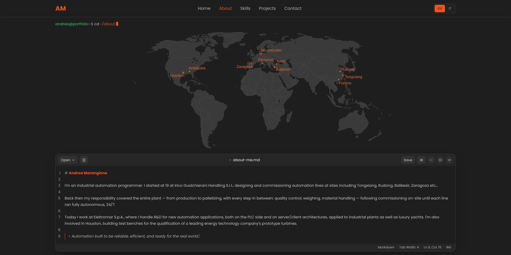
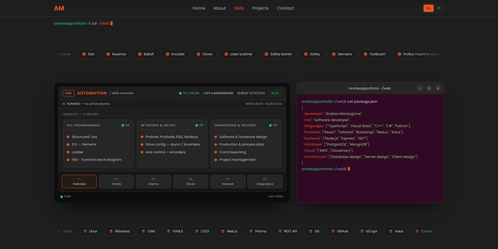
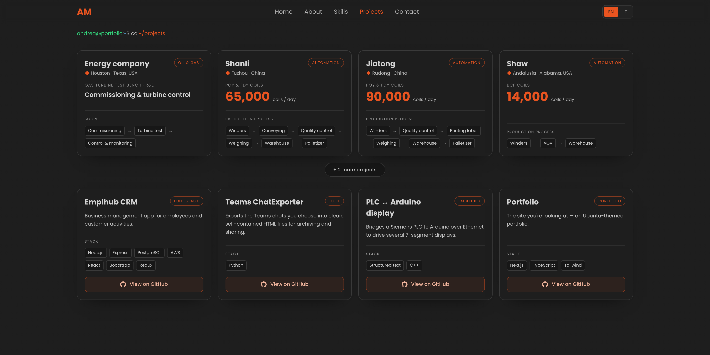
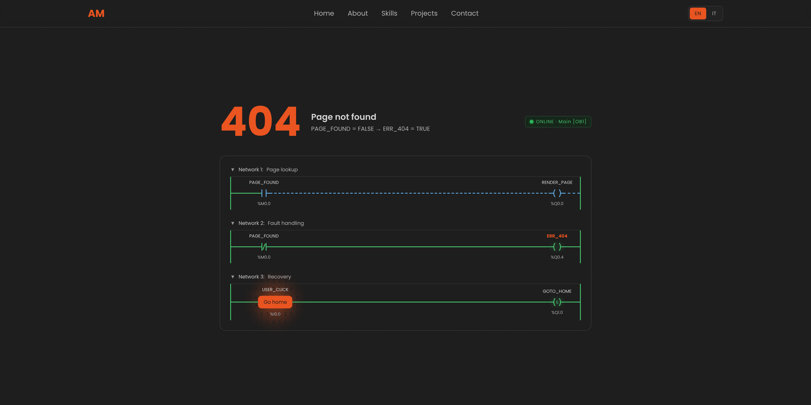

<div align="center">

# Portfolio

**A portfolio for industrial automation work — built like the screens that work happens on.**

Plants, sites and tools from years of commissioning around the world, in a
bilingual Next.js site styled after an Ubuntu desktop.


[**View Live Site**](https://andreamarangione.com)

</div>

> [!NOTE]
> The site is bilingual. Every page exists in English (`/en`) and Italian
> (`/it`), and any address without a language prefix redirects to `/en`.

---

## What it is

Industrial automation is hard to put in a portfolio. The code belongs to the
customer, the plants sit behind a fence on the other side of the world, and a
PLC program means little to anyone who has never stood next to the machine it
drives.

This site shows what can be shown: where the work happened, what the plants
produce and how their lines are built, the tools used along the way, and how
to get in touch. The interface borrows from the places that work actually
happens in — an Ubuntu desktop with terminal and editor windows, an operator
panel, a live P&ID and, when something goes wrong, ladder logic.

---

## Preview

**Hero** — a live P&ID of a gas turbine test bench runs behind the introduction.


**About** — the sites on a world map, the story in a Markdown editor.



**Skills** — automation modules on an HMI panel, the software stack in a terminal.



**Projects** — plants with their daily capacity and production flow, software with its stack.



**404** — a missing page explained as a ladder network; hovering *Go home* energises the coil.



---

## Features

- **Live P&ID** — an ISA-5.1 diagram of the test bench drawn behind the hero,
  with animated gas flow and process values in the reader's units: °F and psi
  in English, °C and bar in Italian.
- **Sites on the map** — on desktop, an SVG world map with SMIL-animated
  markers; on mobile, a 3D globe that is only loaded when it scrolls into view.
- **Skills as equipment** — automation modules on an HMI panel with a live
  clock and status LEDs, the software stack as `cat package.json` in a
  terminal, and two marquee rows of tools.
- **Projects as plants** — every plant card carries site, product, daily
  capacity and production flow; software projects link to their repositories.
- **Editor windows** — About and Contact are written as Markdown documents,
  with a status bar that reports line and column of the cursor.
- **Fault pages** — the 404 and the error boundary are ladder networks, with a
  recovery rung that energises when its button is hovered.
- **Bit background** — a canvas of binary digits lit by an orange glow that
  follows the pointer, enabled only on devices with a fine pointer.
- **Bilingual** — locale routes, typed dictionaries, a language switch and
  locale-aware number formatting.
- **Search and sharing** — canonical URLs, hreflang alternates, a sitemap,
  Person structured data and an Open Graph image generated per language.

---

## Architecture

<picture>
  <source media="(prefers-color-scheme: dark)" srcset="assets/architecture.png">
  
</picture>

---

## Requirements

| | |
| --- | --- |
| **Runtime** | Node.js 24, pinned in `.nvmrc` |
| **Package manager** | npm |

---

## Running locally

**1. Clone the repository**

```bash
git clone https://github.com/AndreaMarangione/Portfolio.git
```

**2. Install the dependencies**

```bash
cd Portfolio
```

```bash
npm ci
```

**3. Start the development server**

```bash
npm run dev
```

The site is served at `http://localhost:3000` and opens on `/en`.

| Script | What it does |
| --- | --- |
| `npm run dev` | Development server with hot reload |
| `npm run build` | Production build, type-checked |
| `npm run start` | Serves the production build |
| `npm run lint` | Runs ESLint |

---

## Notes

- **Content lives in the dictionaries.** Every string on the page is in
  `src/i18n/dictionaries/en.ts` and `it.ts`. The Italian file is typed against
  the English one, so a missing key fails the build.
- **Pages are static.** Both locales are generated at build time and
  revalidated once a day. There is no database and no API.
- **Deployment.** Every push to `main` is built and deployed by Vercel.
- **No analytics.** The site does not track its visitors.

---

## License

Distributed under the **GNU General Public License v3.0**. See [`LICENSE`](LICENSE) for the full text.
